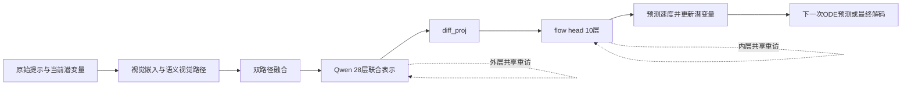

# 统一多模态生成模型共享循环研究：技术报告与后续交接

编写日期：2026-10-23。已完成实验的证据截止日期：2026-10-10。报告对象：接手代码、复核结论、继续研究的工程与研究人员。

本文回顾从环境建立、基线剖析、共享层压缩，到中途理解反馈、同状态成功教师、共享修复器训练、过程监督、读出容量及参考计算图数值诊断的整个流程。本次编写只核查本地保存的文档、源码、核验凭证与历史工具记录，没有重新训练、生成、评分或查询服务器。因此，文中的“完成”指已有完成证据；历史进程号、连接状态和自动轮询设置不能用来判断2026-10-23的服务器实时状态。

所有文件路径均相对于你指定的输出目录书写，例如 `.\stage3_grounded_repair\capture_repair_states.py`。报告没有引用你准备删除的大体积运行展开目录中的文件；关键数字、方法定义、失败原因边界、版本账和接续步骤均在本文中说明。保留本文、顶层源码、顶层核验JSON及配套证据索引，即可阅读和理解交接；重新运行模型还需要权重、数据、状态tensor和检查点，不能只靠文字报告恢复。

## 1. 最终得到了什么

研究已经建立一套可执行、可反传、可核验的Show-o2共享循环实验系统，但还没有完成“以更少参数和计算获得更好的生成与理解能力”的最终目标。最可靠的收获包括：真实的成本和压缩失败证据；中途关系证据的诊断能力；若干经过完整延续与质量守门的成功教师；小样本学习读出的实际翻正；以及关于保真覆盖、目标方向、循环表征漂移和有限精度参考图的系统诊断。

必须分开看待三种正向结果：

1. **存在可行修复终点。** 离线几何或原生教师，在同一原始中途状态上，通过完整剩余生成轨迹得到官方语义翻正且HPS/Pick不下降的终点。它证明训练目标有实际可行样本。
2. **学习读出可以在见过的少量状态上翻正。** v56中循环读出和无循环读出都把三个错误TRAIN状态翻正，各有两例同时过HPS/Pick门；但各伤害一个原正确态，整体HPS为负。
3. **共享循环本身有额外收益。** 这要求循环优于匹配的无循环/冻结核心对照、正确证据优于乱序/反向证据，并通过独立验证。现有证据尚未满足这一层。

| 核心问题 | 当前可以下的结论 | 仍缺什么 |
|---|---|---|
| 能否运行、训练和审计真实共享Transformer循环 | 已实现外Qwen、内flow及联动；零操作、完整终点梯度、来源与冻结核验已建立 | 这些是工程正确性证据，不是质量收益 |
| 独立预训练层能否直接绑定成少量共享层 | 本项目多种有限后训练方案发生明显质量退化 | 更强的训练策略或从训练阶段设计的共享架构 |
| 中途MMU能否识别部分关系错误 | 12个历史开发样本的中段反事实证据AUROC约0.9429 | 大样本、其他语义与质量类型、独立校准 |
| 中途错误能否被物理改动修复 | 找到六个严格TRAIN教师，另有一个DEV教师隔离保留 | 自动部署修复器的整体质量和保真 |
| 学习读出是否完全无效 | v56有实际TRAIN修复；因此不能说完全无效 | 循环特异性、证据特异性、35正确态保真及泛化 |
| 后期循环训练是否过容量门 | v64、v66、v72、v74、v78、v81均未过各自固定门 | 更准确定位优化/表征/目标之间的限制 |
| 数值参考图问题是否存在 | 缓存参考与逐循环重算参考的零反馈梯度残余有显著差异；同前向已核验 | 数值问题不是已证实的统一失败原因；v81修正后容量仍未过 |
| 总参数/FLOPs是否下降且质量提高 | 没有联合达成 | 后期原型保留所有原独立层，额外存储参数1,669,768；FLOPs未测 |
| 广域GenEval、FID/FVD、人评、多样性、理解反向提升 | 未完成 | 完整任务协议与足量独立评价 |

截至已有完成凭证，第三阶段累计**10,960次实际参数更新、10,465次外部optimizer.step调用**；评分记录4,264条，包含明确的基线别名和内容复现，不能当作4,264张独立图像。控制器训练更新为0。v82只有启动器提交记录，没有完成核验，不能追加计划中的两次解析拟合或两项测试。

本节主要依据：`.\stage3_grounded_repair\STAGE3_POSITIVE_RESULTS_20261008.md`、`.\stage3_grounded_repair\STAGE3_ANALYTIC_READOUT_20261008.md`、`.\stage3_grounded_repair\v78_complete_portable_verification.json`、`.\stage3_grounded_repair\v81_complete_portable_verification.json`。

## 2. 研究目标与系统概念

### 2.1 原始目标以及研究路线为什么改变

最初的问题是：统一多模态模型能否读取正在生成的视觉状态，在预算约束下有选择地重复共享计算，提高指令遵循、视觉质量和偏好，同时保留同一提示下的有效多样性。共享参数的意义包括减少独立深度，循环次数的意义包括可变推理计算，两者需要分别证明。

最初直接改造flow头，试图先获得可用的压缩和多深度出口。多种方案出现“速度/表征损失下降，完整采样却退化”的现象。此后将主问题拆开：先验证中途观察信号，再找同状态可行修复，再训练固定修复器，最后才考虑动态控制和压缩。第三阶段暂时保留原骨干，是为了隔离修复机制；这是一种研究分解，没有取消最终参数与计算目标。

原始研究设计见 `.\hybrid_visual_generation_research_plan.md`。该文件是当时的文献分析和实验计划，不能把其中计划的训练规模、硬件或评价项目当作已运行结果。本文不重新核验其中的外部论文，也不将历史文献描述作为实验结论。

### 2.2 实际加载的基础模型

主实验采用Show-o2官方1.5B版本；“1.5B”是版本和语言骨干命名。本项目对主网络去重后的唯一参数计数是**3,063,740,640**，不包含外置VAE和独立奖励评价器。实际通路有26层语义视觉编码器、28层Qwen语言/多模态骨干、10层flow头。

每次速度预测都经过视觉路径与Qwen，Qwen并非只在生成开始编码一次文本。432×432图像对应16×54×54潜变量；2×2 patch得到729个视觉token。主要宽度为Qwen 1536、语义通道1152、flow头2048。CFG使用5.0。



这里的“外层”指Qwen语言/理解骨干的共享重访，“内层”指flow头的共享重访；它们不等同于ODE时间步。增加MMU问答次数也不等同于Transformer层循环。

实现入口：`.\stage3_grounded_repair\runtime.py`、`.\stage3_grounded_repair\outer_shared_revisit.py`、`.\stage3_grounded_repair\trainable_recurrent_state.py`、`.\stage3_grounded_repair\reference_recomputed_repair.py`。

### 2.3 时间、状态和完整延续的约定

采用官方shifted Euler时间网格。**50个时间节点意味着49次速度预测**，不是50次。原10块flow头因此每图执行490次块调用。时间方向为噪声到数据：

\[
z_t=(1-t)\epsilon+t z_1,\qquad v^*=z_1-\epsilon,\qquad
\widehat z_1=z_t+(1-t)\widehat v_t.
\]

零基index35是第36次速度调用，实际时间约0.455；index22约0.214，index30约0.345。它们来自非线性网格，不能直接用35/49当实际t。第三阶段的大部分教师/修复实验在index35保存分叉点，物理更新后完整执行14次剩余速度预测。

“同状态配对”要求保存并核查原潜变量、prompt、seed、实际时间网格、flow_index、CFG、RNG及state fingerprint。相同提示和seed不足以保证配对有效。若修改了物理潜变量或外层输入，旧KV及旧inner prefix不能用于继续生成；捕获的原状态特征只允许按fingerprint/prompt/index绑定使用。

### 2.4 理解证据与修复动作

MMU反事实关系证据为：

\[
m(q)=\log P(Yes\mid q,z)-\log P(No\mid q,z),\qquad
E=m(q_{target})-m(q_{opposite}).
\]

它用目标关系与相反关系的差，减少直接问“图是否满意”的顺从偏置。证据编码器随后可读取目标/反向判断的hidden、margin、时间和关系信息；修复映射还读取当前视觉token与二维坐标。**证据能区分或影响输出，不代表输出变化方向正确。**

后期head把外/内视觉特征、局部field和坐标拼成3716维token输入，经RMS归一化和3716→128→64的SiLU MLP预测patch级物理增量。输出通过原模型unpatchify映射回潜变量，并给条件/无条件分支相同的物理delta。教师、像素、外部mask、父图及终点标签只允许用于TRAIN目标准备和分析，不能进入部署动作选择。

## 3. 数据、指标和证据的共同规则

### 3.1 不同阶段的数据不能混算

| 数据组 | 规模/用途 | 解释边界 |
|---|---|---|
| 第一阶段质量开发集 | 14提示×4seed，56图 | 工程和早期质量开发，不是最终测试 |
| 常用小pilot | 14提示各一个固定seed，14图 | 与56图均值不同，不可交叉充当基线 |
| 早期GenEval分层子集 | 6类别×12，72图 | 是子集比例，不是完整GenEval成绩 |
| 历史空间关系开发集 | 12提示，常有2或4seed扩展 | 已多次用于开发，不再称独立test |
| 自生成重编码图 | 先14、后42张 | 训练可行性/早期蒸馏，小规模且存在同提示开发 |
| 原模型真实ODE轨迹 | 420条×49速度状态=20,580状态 | 改善训练状态匹配，不代表更大独立评价集 |
| COCO真实flow训练 | 512训练图+64验证图 | flow验证和终图质量评价是不同集合 |
| canonical TRAIN池 | 56提示×2seed=112个中途状态 | 第三阶段固定监督源池，非全部都是教师 |
| 早期修复器cohort | 3错误教师+3正确态，共6态、5独立提示 | TRAIN容量和机制诊断，不代表六独立提示 |
| 保真扩展集 | 3教师+35真实正确态=38态 | v58以后多项容量诊断使用 |
| 最新统一训练集 | 6教师+35真实正确态=41态 | v70以后固定抽样/初始化/目标比较 |

第三阶段早期进行过独立于其训练部分的val检查，结果未建立修复收益；后来并没有因为在TRAIN反复诊断而获得新的独立验证结论。DEV成功教师一直与TRAIN隔离，dev/val/test禁止转入后期训练。

### 3.2 六个严格TRAIN教师

六教师均为seed101、flow_index35，来自同一个112状态TRAIN池。简称省略公共前后缀，但接手者必须保留完整state_id。

| 简称 | 完整state_id | 提示关系 | 目标来源 |
|---|---|---|---|
| 00006 | train_extra_00006_seed101_i35 | car below frisbee | 新原生父轨迹，经v69实际加法接口验证 |
| 00010 | train_extra_00010_seed101_i35 | motorcycle above sandwich | 同上 |
| 00021 | train_extra_00021_seed101_i35 | cow right of refrigerator | 原几何教师，v49 FP32增量与v50已评分加法终点 |
| 00039 | train_extra_00039_seed101_i35 | horse above frisbee | 原几何教师，v49/v50 |
| 00046 | train_extra_00046_seed101_i35 | frisbee below couch | 原几何教师，v49/v50 |
| 00054 | train_extra_00054_seed101_i35 | horse below frisbee | 新原生父轨迹，经v69实际加法接口验证 |

hidden目标统一使用v71建立的**actual-additive**教师特征。不能把v36/v68的直接导入终点或v49的direct hidden替换进来。有限精度下，先直接导入目标tensor与先做FP32差分再加回原状态不一定产生完全相同的终点，故必须验证真正使用的加法接口。正确保真目标是原始物理状态和真实基线终点，不是随意增加的弱正则。

来源与数据实现：`.\stage3_grounded_repair\process_training_targets.py`、`.\stage3_grounded_repair\expanded_process_corpus.py`、`.\stage3_grounded_repair\expanded_recurrent_protocol.py`、`.\stage3_grounded_repair\STAGE3_EXPANDED_CORPUS_20261008.md`。

### 3.3 两种门槛不能混为一种

**离线成功教师/实际修复的质量门**：同原状态完整延续后，官方语义错误→正确，同时HPS和PickScore为有限值且相对原基线不下降。SigLIP完整报告，但不能替代前两项偏好门。语义正确但人物/材质/画质退化的候选，不因关系翻正就自动成为合格教师。

**后期TRAIN物理容量门**：六教师各自规范化物理MSE<0.01，全部35真实正确态的最大MSE<0.001。三教师阶段也按同一逐教师及全部35保真原则执行。这个门是进入昂贵终点评价前的筛选条件，不是图像质量指标；过门后仍须新的完整终图验证。不能以均值掩盖某个教师或正确态未过门。

物理误差分母：教师使用目标delta的均方能量，正确态使用原latent的均方能量，均clamp_min(1e-5)。终点误差有独立的终点目标尺度。不同表征/归一化下的MSE不可直接当作同一量纲比较。

### 3.4 评价、成本与核验

- 官方GenEval判断指定对象/属性/关系；HPSv2、PickScore是偏好代理，SigLIP是文图匹配代理；它们都不等于真人总体偏好。
- 翻正与翻负成对报告。离线质量守门oracle读取终点标签进行选择，只是分析上限，不能部署，也不能称学到的controller。
- 统计单位优先提示；同提示多seed应聚类。早期小样本bootstrap没有消除反复开发、挑检查点带来的偏差。
- 唯一参数、块调用数、名义速度次数、反向checkpoint重算、支持算子FLOPs、实际墙钟、峰值显存和端到端成本分别记录。不同GPU批次时间不能直接支持加速结论。
- 便携核验中的passed表示所声明的字节、来源、日志或统计检查通过，不表示算法成功。服务器Torch实际前向/反向与本地标准库核验不同；本地没有Torch模型重跑。

## 4. 第一阶段：环境、完整基线与成本剖析

官方代码固定commit为45a5a2de01d1ebd10cd5864d29310a76476cdf23。基础权重文件5,661,862,314字节，SHA256为a596cbc305c1df987c125d4f218e78f39b681621904cccfb2a3bf0ca0327f92c。配套Qwen2.5、SigLIP SO400M及Wan2.1 VAE。处理了本地权重路径、避免重复初始化Qwen、检查meta参数、补充decord以及关闭TorchDynamo的环境兼容问题。

最初盘点8张物理RTX3090，其中物理5无法正常获取设备句柄，基线使用其他7张健康卡。规划中的两张96GB RTX6000 Pro尚未成为本项目实测结果。后续使用GPU UUID绑定，避免CUDA逻辑编号误导；也不干预其他用户的任务。

56张432px基线全部生成成功。排除每卡首张插桩图后，49张的中位总耗时12.293秒，速度预测12.134秒，输入准备0.034秒，VAE解码/保存0.133秒；已分配显存峰值约8.109GB，预留约8.642GB。插桩组件GPU累计时间为Qwen6.530秒、语义Transformer1.778秒、视觉嵌入0.091秒、融合0.052秒、flow头3.559秒；有插桩影响，不能相加当普通墙钟。

另对14张自生成图重编码训练q/v rank16 LoRA，200步，可训练1,064,960参数，单步中位0.1835秒、峰值约8.388GB。它证明轻量训练可运行，没有证明生成质量提高。基线56图PickScore为22.2137；14图pilot为22.2914，二者不能混用。

交接入口：`.\stage1_showo2\STAGE1_REPORT.md`、`.\stage1_showo2\prepare_checkpoint.py`、`.\stage1_showo2\run_baseline.py`、`.\stage1_showo2\launch_all_gpus.py`、`.\stage1_showo2\aggregate_results.py`、`.\stage1_showo2\train_probe.py`。

## 5. 第二阶段：直接压缩、真实轨迹与保真重访

### 5.1 最直接的4+2×3共享布局失败

把10块flow头改为4独立块加2共享块最多访问3次。L1/L2/L3分别执行6/8/10次块调用；L3与原模型深度相同但唯一块更少。42张自生成重编码图，rank16适配器246,784参数，训练500步。中间出口速度MSE从8.432/5.759/4.121降到0.358/0.337/0.327，终图仍大量噪声、周期纹理。

| 56图配置 | 头部调用 | PickScore | 相对基线Δ | 中位秒 |
|---|---:|---:|---:|---:|
| 原版/D10 | 10 | 22.2137 | 0 | 12.308 |
| L1 | 6 | 16.4897 | -5.7240 | 11.093 |
| L2 | 8 | 16.6875 | -5.5262 | 11.679 |
| L3 | 10 | 16.4217 | -5.7921 | 12.462 |
| D6冻结截层 | 6 | 16.5576 | -5.6562 | 10.957 |
| D8冻结截层 | 8 | 18.0464 | -4.1673 | 11.580 |

D10与原模型56图逐像素一致。L1/L2/L3的Pick和SigLIP均0/56胜出。组内SigLIP距离从基线0.0710变为L1/L2/L3的0.0307/0.0254/0.0249；不能把失真或模式收缩后的数值解释为有效多样性。结论限于当前改造与后训练方式：独立预训练层不能直接绑定后期待功能自动保持。

依据：`.\stage2_loop\STAGE2_REPORT.md`、`.\stage2_loop\RESEARCH_DECISIONS.md`、`.\stage2_loop\train_elt.py`、`.\stage2_loop\run_elt_infer.py`、`.\stage2_loop\run_head_truncate.py`。

### 5.2 改用真实ODE轨迹并审查组件差异

收集420条真实原模型轨迹，避免只在真实/重编码图加噪状态上训练。尾部共享与MLP-only共享的1800步训练各约180.5M可训练参数，峰值约12.4GB；56图Pick相对基线仍约-1.52至-1.19，明显好于直接循环但未恢复基线。

72保存状态的组件绑定MSE：原始重算约0.0000026，只共享norms0.00276，MLP0.16999，attention0.49884，adaLN0.94756，MLP+adaLN1.00578，attention+adaLN1.27061。条件调制及注意力具有显著层间功能差异；不能从norms近似相似推断整块可互换。

### 5.3 CYCLE、SEQUENCE、MIDDLE与SVD残差

CYCLE整体重复共享组，SEQUENCE在相邻位置连续访问共享块，MIDDLE保留前后段、共享中段。用低秩SVD残差近似原层相对共享核心的功能差异。

- CYCLE rank1024少约144.2M唯一参数，56图PickΔ-0.452；另36条未用于该轮开发提示Δ-0.303。
- rank1280初始保存状态MSE0.01533优于rank1024训练后0.02874，但继续1800步后0.02163反而比其自身初始更差。
- SEQUENCE rank1280初始MSE0.02248，MIDDLE0.01076；终图语义没有按这一下降顺序改善。
- MIDDLE满秩初始化14图PickΔ约-0.0078，可视作功能恢复参考；残差成本高，不构成有效压缩。

72图官方GenEval：原模型50节点46/72，CYCLE50节点43/72；原模型60节点46/72，CYCLE60节点45/72；MIDDLE50节点42/72。CYCLE60相对同节点原模型比例差-0.0139，配对区间约[-0.0972,0.0694]，不能称质量提升。MIDDLE颜色属性类2/12，对原模型6/12。

early readout降低局部误差却生成模糊图；最终头Pick微调250步仍Δ-0.2135。MIDDLE真实COCO训练600步使flow验证MSE0.1515→0.1150，但终图PickΔ-0.2479。由此确定：完整终图必须进入决策，局部拟合只能作为诊断。

源码：`.\stage2b\elt_model.py`、`.\stage2b\collect_trajectories.py`、`.\stage2b\collect_student_rollouts.py`、`.\stage2b\train_elt_onpolicy.py`、`.\stage2b\run_elt_onpolicy.py`、`.\stage2b\early_readout.py`。

### 5.4 保留原路径的零门控重访

先执行原flow块0–7，再用原块2/3/4的同一权重处理当前hidden，通过2048维逐通道门混回，然后原块8/9。零门初始化14图逐像素恢复基线。这里保留全部10唯一块，每速度执行13块，50节点每图637块；它隔离“额外共享更新是否有用”，没有压缩参数。

另一loop solver把10块在一次速度预测内访问两次。25节点480块，近原模型50节点490块；14图Pick为22.2268，对同25节点原模型22.2235，仅微小差异，仍低于50节点22.2914。外层节点减少还改变Qwen和语义路径成本，块数接近不等于整网等FLOPs。

### 5.5 单步与最终4步奖励训练

真实图单步干净预测的质量梯度训练门控100步，在14图PickΔ+0.00844；72图GenEval46/72→48/72，但PickΔ-0.00156、HPSΔ-0.000314，HPS区间约[-0.000602,-0.000051]。两例语义翻正没有带来独立偏好整体收益。

最后4个flow节点展开，对最终解码图Pick反传并锚定原终点latent，实际入口为train_gated_quality.py的 --rollout-steps 4 --checkpoint-rollout。无checkpoint时3090显存不足，加入梯度checkpoint峰值约19.8GB。开发选择的100步模型在72图GenEval仍46/72，PickΔ+0.00697，HPSΔ-0.000132，区间含0。小开发集上的正奖励不能替代独立代理、人评或测试集结果。

实现：`.\stage2b\gated_revisit.py`、`.\stage2b\train_gated_quality.py`、`.\stage2b\loop_solver_model.py`、`.\stage2b\train_loop_solver.py`。

### 5.6 7块、9块及第二次访问rank256差异

| 配置 | 唯一参数 | 相对原参数 | 单次CFG速度支持算子TFLOPs | 质量结果 |
|---|---:|---:|---:|---|
| 原模型 | 3,063,740,640 | 基准 | 10.0194 | 基准 |
| 7唯一块短出口 | 2,805,741,408 | -8.42% | 9.2715 | 2000步短出口Pick约-3.87；完整出口另为-3.73 |
| 9唯一块短出口 | 2,977,740,896 | -2.81% | 9.7701 | 最好位置仍退化 |
| rank256短出口 | 2,992,699,616 | -2.32% | 9.7701 | 局部蒸馏后PickΔ-0.3607 |
| rank256完整循环 | 同上 | -2.32% | 10.0657 | PickΔ-0.1999，HPSΔ-0.002215 |

7块方案保留前2、共享中3访问2次、后2；训练2000步未救回质量。9块方案逐位置筛选“前一块替代下一块”，挑1→2和7→8做3000步ILSD/局部教师训练；1→2 ILSD完整出口最好约PickΔ-0.2350，仍不达基线。

rank256在第二次访问加SVD初始化投影残差和目标norm，试图保留首次访问并恢复被替代层。2500步后虽更接近原功能，完整循环计算比原模型高约0.46%。此表FLOPs只覆盖profiler支持算子的单次CFG预测，不含VAE、MMU、全采样及不支持算子，不能作为完整系统效率结论。

### 5.7 COCO真实flow再训练与停止条件

对rank256模型，用512真实COCO图、64留出验证，flow matching+教师速度锚，同时监督短/完整出口。共享核心和残差一起更新，400/800步完整flow MSE分别0.150802/0.150423，优于原模型0.151512；但14图完整PickΔ-0.3895/-0.6740，HPSΔ-0.004063/-0.007725。出现主体消失、构图漂移等案例后停止继续1600步，不能把中间保存计为1600步完成。

后续revisit_only冻结首次访问核心，仅更新第二次残差，400步已完成；短出口MSE0.152113与初始化相同，完整0.151640，未超过原模型。更晚的第三阶段收尾记录已补齐：完整出口14图Pick为22.03532，对基线22.29141，Δ-0.25609；HPSΔ-0.002999，区间[-0.006156,0]。空间固定出口也已完成：短4/12、完整5/12、原版5/12，没有净语义收益。不能再沿用早期全文中的“待确认”状态。`.\stage2b\early_bridge.py`也只是未完成集成的草稿。 上述两项收尾直接依据 `.\stage3_grounded_repair\STAGE3_STATUS_20261004.md` 的后续记录。

### 5.8 中途理解证据、条件循环与配对基线纠错

12空间提示原模型5/12正确，反事实MMU证据在index30/35的AUROC约0.9429，阈值0触发5个基线错误；index22为0.6857。模糊整句满意度问答AUC约0.49。它支持改进证据形式，但样本小且用于开发。

证据触发同一时间点的共享重访并延长后续4次深路径：原模型门控重访没有翻正，压缩模型条件循环4/12对原模型5/12，还损伤一个正确例。一个样本的缓存实现与完整重算像素最大差0，不能扩称所有缓存路径已全面等价。

用MMU梯度干预原模型完整10块，试图区分“观察器不准”和“修复接口无执行力”。 共五种设置：t约0.455单次强度0.6/2/8，t约0.345单次强度8，以及t约0.345连续四步强度2；全部12图仍5/12、0翻转。四步设置48次MMU检查、17次实际干预。最初跨脚本HPS约+0.01036的提升，因两套无干预基线不一致被撤回；同路径重做后，t约0.455强度8的HPS为-0.001729，区间[-0.004578,0.000468]；t约0.345四步强度2为-0.000427，区间[-0.001709,0.000570]，没有质量成功。**这次实际纠错促成了第三阶段严格同脚本零干预、状态hash与终点复现规范。**

理解隔离检查曾在一个固定真实图问答上得到logits最大差0，证明该输入的路径隔离；不等于VQA/MME/POPE保真，更不等于循环理解提高。两问题MMU检查的支持算子成本约5.3284TFLOPs，也不能当免费反馈。

本章详证：`.\LOOPED_UNIFIED_VISUAL_GENERATION_FULL_PROGRESS_20261004.md`、`.\stage2b\EXPERIMENT_LOG_20261003.md`、`.\stage2b\MIDCOURSE_GROUNDED_LOOP_STATUS_20261004.md`、`.\stage2b\mmu_evidence_reader.py`、`.\stage2b\calibrate_mmu_evidence.py`、`.\stage2b\profile_recurrence_budget.py`、`.\stage2b\profile_mmu_evidence.py`。

## 6. 第三阶段前半：先回答“错误是否真的可修复”（v1–v24）

第三阶段先冻结基础模型，保存同一生成状态，再比较不同动作的完整continuation。这样将三个问题分开：证据是否识别错误、动作本身是否改变正确对象、改变能否在剩余flow中保留且不伤害质量。只有找到严格成功教师才训练修复器，避免让控制器学习无收益动作的触发规律。

### 6.1 v1–v5：语义提示和普通共享重访没有形成教师

v1在12开发提示、2seed、2中途点、8动作上生成384终图。动作含基线、未训练零条件重访、普通共享重访、额外一次ODE、目标/反向hidden注入、长提示/相反提示强化。48个零操作全部严格复现latent且像素差0。基线正确率20.83%；全部动作0错→对，普通重访和额外ODE各伤一个正确态，提示强化各伤两个。

v2换成简洁布局计划、区域flow、空间语义共享重访及相反方向，384图仍0翻正。v3只把干预改到index20/25，其余冻结，384图仍0翻正。三轮1152动作图证明“早些检查、更多共享计算、加入正确关系文字”并不自动产生执行力。非零动作确实改变终点，不能把失败解释为动作根本没执行。

v4在96中途状态审计MMU、predicted-clean检测和沿轴反射。index35双对象17/24可检出；水平定位判断约63%–68%，垂直约80%–89%。全局最终成败排序好，不意味着能精确定位实例。v5把对象名token绑定到空间query/key注意力先验，只在额外共享访问改变mask，并比较原block2与更接近深度的block8；24态×6动作=144终图仍0翻正，各非零路线有正确态损伤。

主要入口：`.\stage3_grounded_repair\capture_repair_states.py`、`.\stage3_grounded_repair\build_repair_candidates.py`、`.\stage3_grounded_repair\diagnose_grounding.py`、`.\stage3_grounded_repair\build_routed_candidates.py`、`.\stage3_grounded_repair\STAGE3_STATUS_20261004.md`。

### 6.2 v6–v8：定位、回溯和中途动作审计

v6对index35且MMU负、双对象可定位的6/24状态，比较latent实例搬移、shared hidden搬移和反向动作。144终图中latent首次翻正开发态00412_seed202，Pick+0.122869但HPS-0.004639，未过质量门；shared路线无翻正、破坏更大。18个合法不触发状态的零变化只是路由无操作，不能当作学得保真。

v7在晚index35检查后回溯同轨迹index20，导入clean或几何目标clean继续，120图目标无翻正，反向动作反而翻正同一开发态且质量仍负。名义速度65对49、视觉块642对490，MMU/检测/VAE另计，没有效率收益。

v8不再只看最终图，而先审计6个可定位状态的原/目标/反向clean，共18中途图。目标和反向均0/6关系正确，且搬移常丢失大对象。失败在恢复flow之前已发生，故不能统一归因于“后续动力学撤销了正确干预”。

实现：`.\stage3_grounded_repair\object_transport.py`、`.\stage3_grounded_repair\build_transport_candidates.py`、`.\stage3_grounded_repair\rollback_evidence.py`、`.\stage3_grounded_repair\build_rollback_candidates.py`、`.\stage3_grounded_repair\diagnose_transport_geometry.py`。

### 6.3 v9–v13：像素教师、最小几何与评测恢复

v9把离线教师改成像素实例搬移、源区清除、确定性WanVAE重编码，并核查官方图像归一化。目标像素及VAE往返均4/6关系正确，原/反向0/6。v10完整120终图目标2翻正、反向0，但两例HPS下降，无合格教师。

v11比较从当前状态反推的局部噪声残差与原seed噪声，将正确几何clean重新桥接到同一时间。144终图中原seed目标4翻正、inferred目标2翻正，平均质量均负。v12进一步采用较大实例锚定、只作必要缩放和固定12px间距，36中途图目标像素及往返5/6正确；同时加入对象身份核查，拒绝把“车厢环境”当成独立train实例。它说明正确几何之外还需守住场景身份和外观。

期间官方评测依赖故障。恢复独立隔离venv，核查PIL先导入、MMCV编译算子、原配置/权重，并用144张已有图验证correct/prompt/reason与旧官方结果严格一致；只补评原图，没有重生成。后续必须完整跑官方/HPS/Pick/SigLIP四槽，不能使用遗漏HPS或SigLIP的旧两槽包装。

v13在同24开发态、六动作、五个实际触发状态上生成144终图。目标原seed4翻正0损伤，基线5/24→9/24，但全24平均Pick-0.207355、HPS-0.003042。只有开发态00412_seed202_i35严格过门：Pick+0.315066、HPS+0.001465、SigLIP-0.002882；SigLIP并非教师非负门，所以仍合格。质量守门oracle仅5/24→6/24。该DEV成功态保持隔离，没有混入后续TRAIN。

截至v13，1968条已评分终图、18次动作级翻正、5个不同prompt/seed曾被纠正；这些并非18个独立教师，optimizer为0。

详证与入口：`.\stage3_grounded_repair\STAGE3_PIXEL_TEACHER_20261004.md`、`.\stage3_grounded_repair\STAGE3_MINIMUM_GEOMETRY_20261004.md`、`.\stage3_grounded_repair\STAGE3_V13_TRAIN_PILOT_20261004.md`、`.\stage3_grounded_repair\pixel_transport_teacher.py`、`.\stage3_grounded_repair\minimal_pixel_teacher.py`、`.\stage3_grounded_repair\fm_rebridge.py`、`.\stage3_grounded_repair\recover_geometry_evaluation.py`。

### 6.4 v14–v19：独立TRAIN数据与场景镜像

v14按关系预先选择24条TRAIN提示×seed101/202，共48态，不按图挑状态。v15/v16完成predicted-clean、定位及最小几何准备；现存顶层材料不足以赋予它们独立的正式终点评分成绩，不能补造。

v17共有10态可双对象定位，8态通过身份/几何门、来自7提示。48态×6动作=288评分终图；两种目标噪声动作各8翻正0损伤，基线18/48→26/48。但实际触发8态中原seed目标平均Pick-0.673195、HPS-0.009613，严格质量通过0。40个未触发态保持基线不代表修复器学会保真。

v18/v19尝试整幅水平场景镜像，保留背景、支撑和遮挡，减少剪贴伪影。v18的60中途图目标像素/VAE5/10正确；v19的288终图原seed4翻正、inferred5翻正，仍0合格教师。对同5触发态，镜像比剪贴的Pick破坏小，但HPS仍下降；镜像中途图本身已质量负，不能把所有损伤归于VAE或flow延续。

### 6.5 v20–v24：token证据接口、噪声相关性与首个TRAIN教师

v20实现MMU证据+当前内容+二维坐标→每token FiLM的共享接口，默认core8并保留core2对照，新增1,390,472参数。完整14次剩余速度可反传，零干预严格恢复，证据梯度非零、base/core hash保持；0 optimizer。这只是训练接口打通，不是学得修复。

v21检验噪声与clean是否应一起镜像。60中途图中像素镜像5/10正确，但直接原生predicted-clean latent镜像解码0/10，有形状损伤。v22被中途可行门停止，未生成终图；这不是一个完成的终点训练失败实验。

v23保留已验证像素镜像→VAE路线，分别使用原seed/inferred残差及其同向相关镜像。288终图三个目标路线各5翻正；只有TRAIN00021_seed101的inferred_correlated目标过门：Pick+0.019726、HPS+0.000732、SigLIP+0.004986。不镜像的inferred同例Pick-0.443037、HPS-0.007324。它成为首个严格TRAIN教师，但全48态平均质量仍负，质量oracle仅18→19，尚非共享循环成功。

v24再捕获32条未用TRAIN提示×2seed=64态，后续与原48态合并。v30恢复导出时只补TorchDynamo环境变量，没有重捕获或改变这些状态。

主要材料：`.\stage3_grounded_repair\STAGE3_TRAIN_TEACHER_20261005.md`、`.\stage3_grounded_repair\v23_portable_verification.json`、`.\stage3_grounded_repair\evidence_conditioned_revisit.py`、`.\stage3_grounded_repair\correlated_scene_mirror.py`、`.\stage3_grounded_repair\build_train_encoded_correlation_candidates.py`、`.\stage3_grounded_repair\prepare_train_expansion.py`。

## 7. 第三阶段中段：训练修复器、外内层联动与实际核心贡献（v25–v48）

### 7.1 v25–v29：初次学习与空间接口

v25/v26用一个严格TRAIN教师和18真实正确态，对inner core8/core2各训练50步。随后冻结12条独立val提示×2seed×5动作×2core，共240终图，基线仅1/24正确，所有证据动作0翻正0损伤。正确证据core8的Pick/HPS约+0.017140/+0.00001017，core2约+0.016509/-0.00001017，HPS区间跨0，core2乱序Pick更好。另发现两组Torch初始化并非匹配，因此不能将差异因果归于core深度。

v27回到TRAIN做16终图诊断，唯一教师仍未翻正，距离仅改善约0.60%/0.41%。约56%的hidden元素BF16后确有改变，排除“改动完全没有进入表示”这一极端解释。

v28以匹配初始化比较FiLM和二维token空间采样，各50更新、16 TRAIN终图。空间路线教师终点距离改善15.20%，但0翻正，Pick-2.042260、HPS-0.025391；反向伤一正确态。v29坐标审计显示位移RMS0.1944token、越界9.77%、非正Jacobian0.148%、58.54%token发生较强插值混合。主要是邻近插值，不能断言大范围折叠是主因。

代码：`.\stage3_grounded_repair\train_token_repair_operator.py`、`.\stage3_grounded_repair\train_capacity_matched_operator.py`、`.\stage3_grounded_repair\diagnose_spatial_capacity.py`、`.\stage3_grounded_repair\spatial_token_revisit.py`。本章各结果概述见 `.\stage3_grounded_repair\STAGE3_PROGRESS_20261005.md`。

### 7.2 v30–v37：外层接口和三教师统一监督

v31把真实共享循环扩展到Qwen：原block25输出后重访原block26/27，再继续原26/27。早期零校准形式为

\[
h'=h+M\{G(h+\delta)-G(h)\},
\]

其中G两次调用同一权重，M只选条件分支视觉token，δ由证据与视觉内容预测。**仅将FiLM置零并不能让额外Transformer恒等，必须显式差分或零输出。** 新增1,192,840参数，5项CPU检查和完整14步反传通过；base无梯度/原core hash不变。插入外层后，旧inner prefix及KV均失效。

v32/v34对新增64态中的11候选分别做镜像和最小几何。镜像0/11，因原对象重叠或纵向排列时镜像并不能创造目标横向间距。最小几何目标像素10/11、VAE往返11/11，经身份审计排除2个融合/身份不清状态，留下9个触发。

v33外层pilot50步、10终图，0翻正0损伤；旧教师距离改善3.45%但Pick-0.102903、HPS-0.000244。评分后遇到布尔cost schema导致汇总失败，只修复汇总，没有重训/重生成/重评分。

v35在64态×7动作得到448评分记录，实际只执行109次终点延续，另339条严格复用基线。两种目标噪声各8翻正，严格新增TRAIN00039、00046；相对基线分别Pick+0.218666/HPS+0.002686、Pick+0.254175/HPS+0.002686。全64平均仍Pick-0.074481、HPS-0.000984，离线oracle17→19。

v36/v37将48+64=112态/56提示，三严格教师+35真实正确态建立显式监督映射，目标tensor与已有来源逐字节保持。新两教师位移约0.05332/0.06722，旧镜像教师约1.07370，差约20/16倍；因此后来按教师目标位移归一化，而不是让大位移教师主导绝对MSE。

依据：`.\stage3_grounded_repair\STAGE3_OUTER_LOOP_PLAN_20261005.md`、`.\stage3_grounded_repair\v33_v35_portable_verification.json`、`.\stage3_grounded_repair\v36_v37_portable_verification.json`、`.\stage3_grounded_repair\outer_shared_revisit.py`、`.\stage3_grounded_repair\prepare_train_target_manifest.py`、`.\stage3_grounded_repair\merge_train_repair_corpora.py`。

### 7.3 v38–v42：外、内、联动以及量纲校准

v38外/内/联动各100更新，公共证据编码初始化与抽样匹配，联动共享EvidenceEncoder。v39固定三教师+三正确态、5独立提示，六态×五动作×三组=90终图，所有动作0翻正0语义损伤。正确证据全体结果为：

| 方法 | Pick平均差 | HPS平均差 | 新两教师距离改善 |
|---|---:|---:|---|
| 外层 | -0.042849 | -0.001180 | 2.65% / 4.79% |
| 内层 | +0.004325 | -0.000570 | 0.69% / 0.71% |
| 联动 | -0.011605 | -0.000814 | 3.14% / 5.56% |

内层乱序证据优于正确证据。三组参数/计算不同，不是等FLOPs架构比较。

v40审计调制尺度：gamma/beta约54%–78%接近固定0.1界限；外层hidden RMS24.46、delta约0.12（约0.5%），内层76.63、delta约0.138（约0.18%）。内层BF16约40%–42%元素未变，但仍不能据此统一定因。v41引入hidden RMS校准，各100更新；v42同cohort90终图仍0翻正，联动新两教师距离改善43.16%/47.72%，HPS却全组负。量纲修正确实增强拟合，未形成语义或质量改善，继续盲扫幅度缺少依据。

材料：`.\stage3_grounded_repair\STAGE3_RMS_CALIBRATION_20261005.md`、`.\stage3_grounded_repair\audit_two_level_modulation.py`、`.\stage3_grounded_repair\rms_scaled_revisit.py`、`.\stage3_grounded_repair\train_rms_two_level_operator.py`。

### 7.4 v43：MMU与T2I不能复用错误的视觉边界

官方MMU输入顺序、时间embedding、modality_positions与T2I不同。T2I的模态起点是time，视觉从start+1；MMU若照搬这段mask，可能遗漏首个视觉token、误含eoi，而且MMU为单分支，不能假设双CFG。新上下文显式传visual_start/count，保留官方问题、文字及注意力mask。

v43三项测试通过，两TRAIN问题的原EvidenceReader margin/hidden严格相等，未训练零循环的完整logits/hidden严格相等；非零探针可把MMU损失梯度传到共享证据映射，base无梯度。0更新，没有理解准确率提升或完整保真结论。MMU/AR共同监督和循环开启的真实理解评测仍未执行。

入口：`.\stage3_grounded_repair\STAGE3_MMU_LOOP_BOUNDARY_AUDIT_20261005.md`、`.\stage3_grounded_repair\mmu_outer_context.py`、`.\stage3_grounded_repair\check_mmu_outer_gradient.py`。

### 7.5 v44/v45：从hidden扰动改为物理latent读出

从原Qwen27/flow9 token提取特征，证据/内容/位置生成width64 field，再共享重访对应末两块，零初始化readout经unpatchify产生两CFG分支相同的物理delta，完整14速度继续。新增head_only对照，区分“输出映射”与“Transformer重访”的贡献。

head_only/outer/inner/joint各100更新，共400；v45四组×六态×五动作=120终图，所有证据动作0翻正，各伤一个正确态，基线3/6→2/6。正确证据joint平均Pick-0.501050、HPS-0.010295。三教师距离下降不能抵消正确态损伤。该轮100步保真抽样仅覆盖35池中的24态；受损正确态确实见过一次，不能归因为完全没见过。

### 7.6 v46–v48：让共享核心本身可训练，再检查其真实作用

v46给共享core q/k/v/o加rank4 LoRA，同一A/B跨一/两次循环重用；outer_ilsd、inner_ilsd、joint_ilsd、joint_terminal各100更新，共400。嵌套监督将高预算终点拟合、低预算拟合与高预算detach自蒸馏按预定日程组合。ILSD和terminal需要的训练rollout数不同，不称等FLOPs。

v47共144 TRAIN终图，所有非零动作0翻正；正确两循环的outer保住原三正确态，其他组各伤一态。HPS平均差outer -0.001506、inner -0.007568、joint_ilsd -0.009074、joint_terminal -0.008708；乱序仍常更好。

v48在固定检查点上复现24旧终点并做24次LoRA-off反事实。有效BF16核心约36%–47%元素确已改变，但三教师物理delta变化仅约0.46%–1.67%，关闭LoRA仍保留大部分拟合。结论是“更新进入了核心，但当时输出对该更新的依赖弱”，不是“所有梯度都有效”，也不是重新训练的无循环架构比较。

主要入口：`.\stage3_grounded_repair\STAGE3_STATE_SPACE_REVISIT_20261005.md`、`.\stage3_grounded_repair\STAGE3_RECURRENT_CORE_20261005.md`、`.\stage3_grounded_repair\STAGE3_CORE_CONTRIBUTION_AUDIT_20261008.md`、`.\stage3_grounded_repair\state_space_revisit.py`、`.\stage3_grounded_repair\trainable_recurrent_state.py`、`.\stage3_grounded_repair\recurrent_training_protocol.py`、`.\stage3_grounded_repair\audit_recurrent_core_contribution.py`。

## 8. 过程监督、可达读出与保真冲突（v49–v62）

### 8.1 v49/v50：必须监督真正执行的FP32加法终点

v49重建三教师+三正确态的15个轨迹状态、14次速度及原Qwen27/flow9表征，原bridge输入及终点严格复现。发现直接teacher_state与original+(teacher_state-original)因浮点舍入不同：cow输入最大差约2.38e-7，可放大为终点最大差0.068964、相对L2约2.49%。这表明接口不能只凭代数等式假定相同，也不自动说明语义已失败。

v50实际评分三个FP32增量加回后的完整终点，三教师仍全部过质量门：cow Pick+0.024065/HPS+0.000488，horse+0.218666/+0.002686，couch+0.254176/+0.002686。只验证了同三个教师在实际接口上可用，没有新增独立教师。后续所有新监督必须绑定已评分additive输入与终点。

### 8.2 v51–v54：过程loss能进入核心，但方向仍不对

v51加入物理delta与实际加法教师hidden过程损失。hidden使用FP32无仿射layernorm，按固定未训练operator的初始误差归一化，目标detach，仅条件视觉token，不包括文字/无条件token。训练hook临时捕获嵌套前缀，异常也清理。五项CPU检查、真实hidden梯度到外/内core及完整14步终点梯度通过。

v52四组joint_control/outer_process/inner_process/joint_process各100更新，共400，其中joint_control与joint_process主比较保持同前向、参数、初始化、目标与抽样，只改变过程辅助监督；外/内过程组的分支设计不同。v53共144 TRAIN终图仍0翻正；outer保住正确态，其他组伤一态。joint_process相对control某些质量损伤减小，但没有超过原基线，三个教师对v50终点距离也没有整体优于control。该轮67教师/33保真步，仅覆盖24/35正确态。

v54只读复现48旧终点并审计物理方向。joint_process对horse/couch的预测更新RMS已达教师97.79%/95.40%，方向cos却仅0.466/0.501；cow RMS19.84%、cos0.335。即使事后选择最优单一缩放，三例相对物理MSE下界仍约0.888/0.783/0.749。这里的解析结果直接说明：当前方向差不能靠继续扫强度消除。

部分core梯度存在冲突，但总损失负梯度对terminal/state的局部导数仍为负。局部夹角不能证明失败唯一来自梯度抵消，更不能据此随意删除监督。

证据与代码：`.\stage3_grounded_repair\STAGE3_PROCESS_SUPERVISION_20261008.md`、`.\stage3_grounded_repair\STAGE3_PROCESS_RESULTS_20261008.md`、`.\stage3_grounded_repair\STAGE3_PROCESS_DIRECTION_20261008.md`、`.\stage3_grounded_repair\export_teacher_process.py`、`.\stage3_grounded_repair\process_supervision.py`、`.\stage3_grounded_repair\audit_process_objectives.py`。

### 8.3 v55：固定特征里是否存在更好的线性输出

固定六TRAIN状态，比较原/已训练特征、循环/无循环、共享一/两预算的五个预定解析ridge探针；ridge固定1e-4，列按加权L2归一化，不扫正则，不动原模型。目标patch通过官方unpatchify逐元素往返验证。

trained_loop2三教师物理MSE为0.429224/0.005653/0.004322，trained_no_loop为0.436771/0.005965/0.004471。后两教师有很好的固定线性拟合，说明之前失败不能概括为“表征完全不可用”；但无循环同样可用，cow仍约0.43，三正确态均值约0.026，也没有解决保真。

### 8.4 v56：最强已评分学习读出结果及其限制

将预定v55两个解析系数部署到现有FP32读出，明确标为原optimizer step100后再解析拟合，不伪称新训练100步。只改变既有四个读出张量，推理不读像素教师/mask/终标签。零读出完整14步严格恢复基线；FP32转换/patch一致性和来源均核验。

在六TRAIN态、五独立提示上进行基线、零、正确/乱序/反向证据等动作，**66条评分记录**：

| 正确证据，固定两循环/匹配无循环 | 错→对 | 对→错 | 正确总数 | Pick平均差 | HPS平均差 | 三教师中严格质量过门 |
|---|---:|---:|---|---:|---:|---:|
| trained_loop2读出 | 3 | 1 | 3/6→5/6 | +0.152168 | -0.001383 | 2/3 |
| trained_no_loop读出 | 3 | 1 | 3/6→5/6 | +0.055603 | -0.001139 | 2/3 |

循环正确证据下，cow虽语义翻正但Pick+0.600267/HPS-0.009033，未过质量门；horse为+0.186040/+0.001953，couch为+0.147878/+0.002197，后两例过门。受损原正确态是train_extra_00002_seed101_i35，终点相对MSE约0.013541，说明较小latent误差也不保证语义保真。

这确实是**学习映射在TRAIN上的实际修复**，不能写成始终0修复；也不能升级成循环特异收益。无循环达到同样翻正数，乱序循环也三翻正/两过门，原正确态受损且整体HPS负。因已用这六态拟合，不能称独立泛化或总体GenEval提高。

### 8.5 v57：同head依赖不等于循环架构优越

固定head不重拟合，交换循环/无循环路由后，循环head的horse/couch终点相对MSE从约0.01131/0.01093变为13.645/18.240，无循环head强行开启循环也明显变差。这证明head依赖自己适配的表征。v56重新拟合的无循环同样能修复，所以不能用“关掉循环后坏了”单独证明循环比无循环更好。v57未新增官方或偏好评分。

v55–v57材料：`.\stage3_grounded_repair\STAGE3_READOUT_CAPACITY_20261008.md`、`.\stage3_grounded_repair\STAGE3_ANALYTIC_READOUT_20261008.md`、`.\stage3_grounded_repair\STAGE3_ANALYTIC_CORE_AUDIT_20261008.md`、`.\stage3_grounded_repair\v56_portable_verification.json`、`.\stage3_grounded_repair\prepare_analytic_readout.py`、`.\stage3_grounded_repair\analytic_readout_operator.py`、`.\stage3_grounded_repair\audit_analytic_core_contribution.py`。

### 8.6 v58/v59：把保真从三态扩到35态后，线性约束显露

v58固定原三个教师，把保真扩到全部35真实正确态，教师/保真总权各一半、ridge不变。v59在相同35态上补齐旧/新读出的配对比较：循环全35态物理MSE均值0.375276→0.041204，无循环0.352649→0.041317，两组均32/35改善；代价是原三个正确态及教师拟合变差。没有新终图质量结果。

v59固定特征，FP64数值标准下保真矩阵秩3715/3717，严格零更新的数值零空间只余2维，无法表达三个教师目标。若按FP32特征分辨率选cutoff，秩分别约2205/2292，剩余方向多，但教师目标残余能量仍约0.399/0.415。这个结论严格限于当前固定线性读出、目标与数值秩定义；不能据此宣布可训练非线性模型或整个循环架构不可达。

### 8.7 v60–v62：非线性头、条件分离和有界优化

v60在固定v52特征上，3716→128→64 SiLU头，循环/无循环各1000次head Adam更新，共2000；core不更新。原三教师+35正确态，三教师物理MSE均值循环0.137871、无循环0.096419；正确均值0.002083/0.002186、最大0.049542/0.044365，全部容量门失败。35正确态都比旧线性拟合改善，但“全部改善”不等于全部过门。

v61只读检查同对象同seed反向关系和同提示异seed。latent、MMU条件与head输入没有完全碰撞；交换target/opposite证据使物理delta相对RMS变化约0.453–1.412。排除了完全相同输入/完全忽略MMU的极端解释，没有证明正确使用证据或改善终图。

v62保持目标/结构/数据，从各自Adam step1000用固定有界L-BFGS再优化。两组各100次内部接受更新、外部step各1次、closure104/105。教师均值降到0.124124/0.083988，正确最大仍0.036421/0.028226，容量门失败。达到迭代上限且梯度非零，不称收敛或结构不可达。缓存head优化时间约0.775/0.762秒，不包含捕获模型特征与加载，不能宣传为完整训练费用。

材料：`.\stage3_grounded_repair\STAGE3_PRESERVATION_COVERAGE_20261008.md`、`.\stage3_grounded_repair\STAGE3_PRESERVATION_RANK_20261008.md`、`.\stage3_grounded_repair\STAGE3_NONLINEAR_CAPACITY_20261008.md`、`.\stage3_grounded_repair\STAGE3_CONDITION_SEPARATION_20261008.md`、`.\stage3_grounded_repair\STAGE3_OPTIMIZER_RESULTS_20261008.md`、`.\stage3_grounded_repair\nonlinear_token_readout.py`、`.\stage3_grounded_repair\preservation_geometry.py`、`.\stage3_grounded_repair\bounded_lbfgs.py`。

## 9. 非线性共享训练、原生教师与全批容量（v63–v74）

### 9.1 v63/v64：从固定特征头回到完整终点训练

v63将非线性head接回可训练共享循环，实模型零完整终点、非零核心/证据梯度及基础冻结检查通过。v64比较no_loop、frozen_loop、trainable_loop各固定210 AdamW更新，共630。每步index35物理更新后完整反传14速度；物理/终点损失各0.5，lr1e-4、wd0、clip1。105教师步/105保真步，三教师各35次、35正确各3次。

两循环组的operator/head起点完全匹配；无循环使用自己已有的head，因此不能说三组所有初始tensor都匹配。冻结低秩参数必须保留已加载LoRA前向：`requires_grad=False`与“把LoRA从计算中关闭”是不同操作，后者不能作为冻结对照。

| 固定step210 | 三教师平均物理MSE | 35正确均值 | 35正确最大 | <0.001正确态 |
|---|---:|---:|---:|---:|
| no_loop | 0.180064 | 0.001209 | 0.013482 | 26/35 |
| frozen_loop | 0.167100 | 0.001222 | 0.022761 | 31/35 |
| trainable_loop | 0.220330 | 0.001346 | 0.025100 | 28/35 |

三组均容量失败，没有新终图评分。v65只读诊断显示16个q/k/v/o有效BF16矩阵有约18.56%–54.31%元素变化，冻结组0；再次排除全部更新被舍入，但不能证明更新方向有用。

### 9.2 v66：跨token输出也未解决容量门

固定v64 trainable_loop operator，用增加跨token交互的读出检验“token局部head不足”的解释，循环/无循环各1000 head更新，共2000，core不更新。新head483,968参数，原token-local484,032，少64个参数不等于整网压缩，跨token注意力成本也没有测量。

| 固定特征路线 | 三教师MSE均值 | cow / horse / couch | 35正确均值 | 最大 |
|---|---:|---|---:|---:|
| loop2 | 0.287606 | 0.738425 / 0.059428 / 0.064966 | 0.000951 | 0.011595 |
| no_loop | 0.237519 | 0.617493 / 0.045751 / 0.049312 | 0.001550 | 0.024556 |

循环保真均值更好、三个教师更差，均未过门。宽度和全局分支同时变化，不能单独将结果归因于跨token通信，不能把一个保真均值优势写成生成架构优势。

对应文件：`.\stage3_grounded_repair\STAGE3_NONLINEAR_RECURRENT_20261008.md`、`.\stage3_grounded_repair\STAGE3_NONLINEAR_MAPPING_20261008.md`、`.\stage3_grounded_repair\STAGE3_GLOBAL_TOKEN_CAPACITY_20261008.md`、`.\stage3_grounded_repair\nonlinear_recurrent_repair.py`、`.\stage3_grounded_repair\global_token_readout.py`、`.\stage3_grounded_repair\audit_nonlinear_recurrent_mapping.py`。

### 9.3 v67–v69：扩充来自基础模型原生轨迹的教师

v67在112 TRAIN态中找到15对“错误seed/同prompt另一正确seed”，其中6个父图满足相对源图HPS/Pick有限非负：00003_seed101、00006_seed101、00009_seed202、00010_seed101、00019_seed101、00054_seed101。另一seed正确图只是候选父轨迹，不能提前计为同状态修复教师。

v68固定index35、原grid/CFG，用源速度构造inferred noise，再桥接原生正确终点：

\[
\hat\epsilon=x_t-t v_t,\qquad x_{bridge}=(1-t)\hat\epsilon+t x_1^{parent}.
\]

不扫描强度、时机、阈值。六候选全部保留并完整四槽评分：

| 动作 | 官方翻正 | 翻正且HPS/Pick非负 | 六态Pick均值差 | HPS均值差 |
|---|---:|---:|---:|---:|
| zero | 0/6 | 0/6 | 0 | 0 |
| 源错误final重桥接 | 1/6 | 0/6 | -0.315719 | -0.001383 |
| 正确父final+源inferred noise | 5/6 | 3/6 | +0.635839 | +0.010824 |
| 直接父中途状态 | 6/6 | 6/6 | +0.636831 | +0.010946 |
| 源状态+父状态FP32差分 | 6/6 | 5/6 | +0.633001 | +0.010661 |

最后两行是跨seed父轨迹上限，不是部署修复。前述原生bridge的三合格教师为00006/10/54；00003未语义翻正、00009 HPS负、00019 Pick负。MMU只识别六源错误中的三个，00010的contrastive evidence甚至+1.5，说明“可修复性”和“当前检查器会触发”并不一致。

36评分记录包含6个baseline字节别名、30次完整14延续；zero/direct内容复现也不能当新的独立样本。v69只对三新教师的实际FP32 source+delta接口重新生成/评分：

| 教师 | Pick差 | HPS差 | SigLIP差 | additive相对direct终点L2 |
|---|---:|---:|---:|---:|
| 00006 | +1.824670 | +0.016846 | +0.138234 | 0.024587 |
| 00010 | +0.376842 | +0.004883 | +0.037254 | 0.019913 |
| 00054 | +1.269771 | +0.016846 | +0.099332 | 约9.06e-9 |

输入最大舍入约5.96e-8，前两终点仍相差约2.46%/1.99%，再次说明必须绑定实际加法目标。三教师均过门，导出原/加法Qwen27与flow9条件特征、14速度/15状态和终点。至此严格TRAIN教师六例、DEV一例，评分记录从4222到4264，新增优化器更新0。

依据：`.\stage3_grounded_repair\STAGE3_NATIVE_TEACHER_20261008.md`、`.\stage3_grounded_repair\STAGE3_NATIVE_RESULTS_20261008.md`、`.\stage3_grounded_repair\v67_metadata_verification.json`、`.\stage3_grounded_repair\v68_portable_verification.json`、`.\stage3_grounded_repair\v69_portable_verification.json`、`.\stage3_grounded_repair\native_teacher_interface.py`、`.\stage3_grounded_repair\build_native_additive_process.py`。

### 9.4 v70/v71：统一41态、目标和真实初始化

新增ExpandedProcessCorpus，保留旧类与旧检查点不覆盖。六教师+35真正确，CPU来源、TRAIN边界、FP32差分、CFG及质量门核验通过。v71重新执行六教师additive完整14终点，严格复现；41循环零终点和六无循环零终点严格等基线，完成六次完整终点反传和独立非零探针恢复。

这一轮三组共用v52 joint_process固定operator和fresh零head，实际adapter/head tensor逐项同hash；共同RMS只从41原状态的两条路线计算，目标不参与。与v64相比，强化了三组初始化匹配；仍不能由接口检查替代质量结果。

### 9.5 v72/v73：六教师匹配训练仍未过门

三组各420固定AdamW，共1260更新。教师/保真交替各210步；六教师各35次、35正确各6次，seed20261008。共同实际初始化、RMS、目标、抽样和损失匹配；主对照可训练/冻结循环只改变LoRA更新开关。两循环每分支额外4块，无循环0。固定step420，不按图挑检查点。

| step420 | 六教师MSE均值 | 旧三教师 | 新三教师 | 35正确均值 | 最大 |
|---|---:|---:|---:|---:|---:|
| no_loop | 0.500909 | 0.550308 | 0.451509 | 0.004164 | 0.015853 |
| frozen_loop | 0.598396 | 0.648475 | 0.548316 | 0.004278 | 0.016890 |
| trainable_loop | 0.545183 | 0.592939 | 0.497427 | 0.003721 | 0.017382 |

v73固定参数诊断：可训练循环相对冻结六教师物理误差都下降、终点误差5/6下降；但无循环的六教师物理和终点误差全部更低。终点均值no_loop0.303449、frozen0.409583、trainable0.374552。这是latent诊断，不是生成质量。有效BF16核心相对共同起点有约39.80%–89.64%元素变化。

### 9.6 v74：去掉终点loss，检验全批物理拟合

三组都从同一个v72 trainable_loop step420参数开始，以41态全批、教师/保真各0.5的物理目标，顺序累积梯度，不逐态裁剪。每组有界L-BFGS固定100内部接受更新、125 closure上限、1次外部step，使用最后接受参数。去掉了终点loss，故它是新的物理容量诊断，不能称继续同一训练目标。

| 路线 | 六教师MSE | 35正确均值 | 最大 | 最终全批目标 |
|---|---:|---:|---:|---:|
| no_loop | 0.217453 | 0.002396 | 0.012791 | 0.109925 |
| frozen_loop | 0.228859 | 0.002446 | 0.013662 | 0.115653 |
| trainable_loop | 0.230679 | 0.002292 | 0.012740 | 0.116486 |

共300内部接受更新、3外部step、312 closure。全部原门失败；trainable对frozen六教师均略差、34/35正确态更好。局部保真取舍不等于整体收益，最终梯度非零也不称收敛。没有新终图/评分/val/controller。

后续输入与核验：`.\stage3_grounded_repair\STAGE3_EXPANDED_CORPUS_20261008.md`、`.\stage3_grounded_repair\STAGE3_EXPANDED_RESULTS_20261009.md`、`.\stage3_grounded_repair\STAGE3_EXPANDED_MAPPING_RESULTS_20261009.md`、`.\stage3_grounded_repair\STAGE3_FULLBATCH_RESULTS_20261009.md`、`.\stage3_grounded_repair\v70_v71_portable_verification.json`、`.\stage3_grounded_repair\v72_complete_portable_verification.json`、`.\stage3_grounded_repair\v74_complete_portable_verification.json`。

## 10. 锚定循环、四循环过程监督与参考图数值修正（v75–v81）

### 10.1 为什么增加原表征锚定

plain循环即使feedback=0，仍把已经过同一Transformer组的hidden再处理一遍，表示会漂移；head输出为0只能保证物理状态不变，不能保证循环内部hidden不变。v75因此实现：

\[
h^{(0)}=h_0+f_\theta(e,h_0),\qquad
h^{(k+1)}=h_0+\left[G_\theta(h^{(k)})-G_\theta(h_0)\right].
\]

G为同一组共享块和同一LoRA。参考G(h0)必须连接梯度，不detach；与当前响应在同一次forward内计算，不能跨原状态复用。feedback=0时前向严格回到h0。它改变了表征接口，并未删除原独立层或新增部署参数。

v75在82个分支/状态上验证零反馈hidden严格恒等，53个完整14步零终点严格基线，五次完整反传、四项CPU检查、探针恢复/base冻结通过。原v74反馈迁到新接口，内层某些保真偏移减小、外层增大；这是固定参数反事实，不是匹配重训的架构胜出。

v76扩展1/2/4预算及(外4,内2)/(外2,内4)/(外4,内4)，41态四循环零head完整终点严格基线，预算前缀复现v75。缓存参考四循环每分支8响应块+2参考块=10块；plain四循环8块；无循环0。用户允许增加调用，故如实增加成本，不再用原预算假装匹配。

### 10.2 v77：冻结actual-additive过程loss和共同起点

四路线anchor_trainable4、anchor_frozen4、plain_trainable4、no_loop共同使用v74最后接受operator，清零feedback、fresh零输出head。RMS从41原状态×四路线等权计算且目标不参与，范围0.036917228–33.318130493，所有实际初始tensor与RMS一致。

新目标为：

\[
\mathcal L=0.5\mathcal L_{physical}+0.5\mathcal L_{terminal}
 +\mathcal L_{hidden},\qquad
\mathcal L_{hidden}=\tfrac12(\mathcal L_{outer}+\mathcal L_{inner}).
\]

hidden为v71实际加法教师特征，FP32无仿射layernorm eps1e-5，目标及尺度训练前冻结；no_loop也有hidden监督。主两anchor路线前向、参数、初始化、数据、抽样、目标、损失相同，只LoRA是否更新不同；plain/no_loop是计算和路由不同的辅助比较。

v77共164个零物理delta严格为0，59个完整14零终点严格基线（anchor_trainable全部41，其他各6），不是四组各41次完整终点。六次完整终点反传、四项新CPU检查通过。零head终点梯度到head为6.165235877，零反馈hidden到feedback为130.258880615，但外/内core仍有1.729821950/0.075567226残余梯度。前向恒等下的残余不能解释为非零循环响应或语义学习；这成为v79的具体数值诊断问题。

证据：`.\stage3_grounded_repair\STAGE3_ANCHORED_RESULTS_20261009.md`、`.\stage3_grounded_repair\STAGE3_FOUR_LOOP_RESULTS_20261009.md`、`.\stage3_grounded_repair\STAGE3_PROCESS_FOUR_LOOP_RESULTS_20261009.md`、`.\stage3_grounded_repair\anchored_recurrent_repair.py`、`.\stage3_grounded_repair\multibudget_response_repair.py`、`.\stage3_grounded_repair\process_four_loop_repair.py`、`.\stage3_grounded_repair\process_four_loop_protocol.py`。

### 10.3 v78：四组各420真实更新，全部容量失败

固定420 AdamW，lr1e-4、wd0、clip1、seed20261008；六教师各35次、35正确各6次，教师/保真交替各210。总1680实际更新/1680外部step，完整173项manifest和全部日志/源码/初始tensor/固定检查点/容量/有效BF16变化已经本地核验。禁止把各7步的启动快照或308步历史前缀当最终结果。

| 固定step420 | 六教师平均MSE | 35正确均值 | 35正确最大 | 训练wall秒之和 | 峰GiB | 有效BF16核心变化 |
|---|---:|---:|---:|---:|---:|---:|
| anchor_trainable4 | 0.528406 | 0.003989 | 0.012320 | 4940.029 | 19.897 | 86.604% |
| anchor_frozen4 | 0.532641 | 0.003908 | 0.012733 | 4932.591 | 19.000 | 0% |
| plain_trainable4 | 0.593299 | 0.001914 | 0.008180 | 5045.206 | 19.115 | 87.443% |
| no_loop | 0.544406 | 0.003363 | 0.009748 | 4825.844 | 15.748 | 0% |

可训练anchor对冻结只改善3/6教师、11/35正确；教师均值差-0.004236但正确均值差+0.0000816。对no_loop改善5/6教师却使全部35正确误差更高；对plain教师好、保真差。六教师每个<0.01与正确max<0.001的原门全失败，没有自动生成新终图。裁剪比例高只是观测，不能直接宣布为失败因果；有效BF16大量改变排除全被舍入。

每组训练完整终点名义速度5880；原41态捕获另计。训练+容量的额外shared调用每分支anchor4610、plain3688、no_loop0；反向checkpoint重算另计。wall为日志内各步之和，不含所有准备/收尾，也不是端到端等FLOPs。

依据：`.\stage3_grounded_repair\STAGE3_PROCESS_FOUR_LOOP_TRAINING_RESULTS_20261009.md`、`.\stage3_grounded_repair\v78_complete_portable_verification.json`、`.\stage3_grounded_repair\v78_capacity_paired_analysis.json`、`.\stage3_grounded_repair\train_process_four_loop.py`。

### 10.4 v79：固定终点、方向和零反馈VJP定位

固定v78全部step420参数，0更新/拟合/新评分，完成164容量/hidden复现、205个固定head预算前缀、24教师完整14步终点latent、六个独立loss梯度和12个零反馈VJP。74项manifest完整本地核验。

| v78固定路线 | 六教师terminal MSE均值 | hidden均值 | 外方向cos | 内方向cos |
|---|---:|---:|---:|---:|
| anchor_trainable4 | 0.304950 | 0.957050 | 0.175668 | 0.363328 |
| anchor_frozen4 | 0.314447 | 0.969411 | 0.165971 | 0.322249 |
| plain_trainable4 | 0.365778 | 1.805142 | 0.133499 | 0.337488 |
| no_loop | 0.378818 | 0.973795 | 0.199787 | 0.178534 |

低hidden/terminal误差没有被新图像评分确认，不能据表称生成质量提高。固定四循环head改1/2/4前缀是条件响应，不是重新匹配训练各预算；也没有按TRAIN图选择最好预算。

最关键的数值比较：四循环零反馈前向严格恒等，缓存连接参考的core梯度绝对和外/内为1.533170881/0.075567226；每循环重算连接参考后为0.000064760551/3.365e-11，feedback梯度仍非零。FP64 toy的理论取消通过，外层真实模型仍非严格零。它支持计算图/有限精度累加的数值问题，但尚不证明这是v78容量失败原因。

### 10.5 v80：同前向的参考重算接口通过

改为每个循环重新计算G(h0)，同G/同A/B跨四次使用，参考不detach。每分支4循环×(2参考块+2响应块)=16额外共享块，缓存方案为10，无循环0；当前保留真实重算成本，不声称已经有部署缓存优化。

实载v78 step420，在41态物理delta及外/内hidden上缓存/重算严格相等；六教师完整终点严格复现v79。fresh零head164物理delta、59完整14零终点，五次完整反传及探针恢复/base冻结通过。49项manifest本地核验，0更新/拟合/评分。零反馈hidden对core残余外0.000173796091、内7.958e-12，外层仍非严格零；与v79单分支loss上下文不同，不要求数值完全相同。

v79/v80关键代码与证据：`.\stage3_grounded_repair\STAGE3_PROCESS_ALIGNMENT_RESULTS_20261009.md`、`.\stage3_grounded_repair\STAGE3_REFERENCE_RECOMPUTE_RESULTS_20261009.md`、`.\stage3_grounded_repair\process_alignment_diagnostics.py`、`.\stage3_grounded_repair\check_process_alignment.py`、`.\stage3_grounded_repair\reference_recomputed_repair.py`、`.\stage3_grounded_repair\check_reference_recomputed.py`、`.\stage3_grounded_repair\v79_portable_verification.json`、`.\stage3_grounded_repair\v80_portable_verification.json`。

### 10.6 v81：修正参考图后匹配训练，容量仍未通过

只新增逐循环重算参考的trainable/frozen两组，各固定420 AdamW，共840真实更新。实际初始tensor、RMS、actual-additive目标、完整420抽样及loss与v78匹配，两个新增主对照之间唯一主变量是LoRA更新。v78缓存anchor和no_loop复用既有检查点，不重训；因调用/wall不同，不称等计算比较。

| 固定step420 | 六教师MSE均值 | 35正确均值 | 35正确最大 | 训练wall秒之和 | 峰GiB | 有效BF16变化 |
|---|---:|---:|---:|---:|---:|---:|
| recomputed_trainable4 | 0.530819188 | 0.003673497 | 0.011814103 | 5005.758 | 22.257 | 86.529% |
| recomputed_frozen4 | 0.529201522 | 0.003231261 | 0.009831423 | 4960.104 | 19.005 | 0% |

两组容量门都失败。可训练对冻结改善3/6教师、6/35正确，教师均值反而高0.001617665、正确均值高0.000442236；对v78缓存组，教师2/6改善、正确32/35改善，仍有取舍。参考重算降低了零反馈梯度数值残余，但没有解决整体容量问题，不能继续把数值残余当唯一解释。

每组训练终点名义速度5880，训练实际shared每分支6720，容量41态各656，合计每分支7376；原状态捕获及反向重算分别计。没有新终图/官方/偏好/val/controller结果。

**v81最终完成证据是102项manifest的完整包与本地passed核验，不是各7步启动快照或各24步最后前缀。** 完成归档14,934,880字节，SHA256为8de6e1bbd3ed4174627f4a78993b0409f8d67426b1e58287d8de8b67c9b5658e。完整proof字段是`actual_optimizer_updates:840`。

入口：`.\stage3_grounded_repair\STAGE3_REFERENCE_RECOMPUTE_TRAINING_RESULTS_20261010.md`、`.\stage3_grounded_repair\STAGE3_REFERENCE_RECOMPUTE_TRAINING_PROTOCOL_20261009.md`、`.\stage3_grounded_repair\v81_complete_portable_verification.json`、`.\stage3_grounded_repair\train_reference_recomputed.py`、`.\stage3_grounded_repair\run_reference_recomputed_training.py`。

## 11. 最后未闭合的实验：v82固定读出子空间诊断

### 11.1 本来要回答什么

v82拟冻结v81两组step420的全部core、feedback、head第一层及其他参数，截取最后Linear真实输入的128维SiLU activation，加bias形成129列，用64个patch输出作为目标，做两次FP64薄SVD最小二乘。目的仅是回答“在当前固定feature下，最后线性输出层的拟合还有多少改进空间”，不推断整个架构全局可达性。

教师每态权1/12、正确每态权1/70，每观测乘：

\[
\sqrt{\frac{w_s}{N_{patch}\cdot64\cdot scale_s}}.
\]

因此目标恰为0.5×六教师物理MSE均值+0.5×35保真均值。用真实unpatchify的索引置换反推patch顺序，要求双射及严格roundtrip；cutoff固定为max(rows,columns)×FP64eps×最大奇异值，不调ridge、宽度、时机、幅度或阈值。解析系数只保存诊断数组，不加载回模型，不计optimizer更新，不生成新终图。

预定保存设计矩阵、目标、解析系数、原系数、全奇异值/数值秩/cutoff、正常方程残余与每态误差；计划1800秒有界worker，先两项CPU单测，核GPU7 UUID和空闲，再执行。预计82原状态捕获、额外外/内shared各1312块是**计划**，没有实际日志不得计为完成调用。

源码与协议：`.\stage3_grounded_repair\STAGE3_READOUT_SUBSPACE_PROTOCOL_20261010.md`、`.\stage3_grounded_repair\readout_subspace_solver.py`、`.\stage3_grounded_repair\test_readout_subspace_solver.py`、`.\stage3_grounded_repair\check_readout_subspace.py`、`.\stage3_grounded_repair\run_readout_subspace.py`。

### 11.2 哪些确实完成，哪些没有凭证

2026-10-10历史记录确认：四份新Python源码和协议已写入、AST解析通过；上传包SHA核对并安装；启动命令返回launcher PID57234。随后读取状态、测试日志和pipeline的调用因自动审批审核无法完成而未执行，原因是当时账户额度限制；不是该只读命令被判定危险，也不是训练/GPU故障的证据。

没有保存v82 worker日志、单测通过输出、激活矩阵、fit结果、完成归档或portable complete proof。所以不能说v82仍在运行、成功或已经结束；不能将计划两解析fit或两测试加到完成账。顶层旧状态写“尚未启动”早于launcher提交，也不是最终实时事实。

### 11.3 本次报告静态审查新发现的确定性缺陷

当前 `.\stage3_grounded_repair\check_readout_subspace.py` 第39行读取：

```python
portable['optimizer_updates']
```

而其指定输入 `.\stage3_grounded_repair\v81_complete_portable_verification.json` 实际为：

```json
{"passed": true, "phase": "complete", "actual_optimizer_updates": 840}
```

没有`optimizer_updates`键。**若按当前源码及该proof运行到这一判断，将触发KeyError，发生在Runtime创建、activation捕获与解析fit之前。** 这是静态可确认的schema不一致；本次未读取远端异常日志，因此不能将推导的失败点伪装成已看到的运行日志。单元测试只导入solver，不覆盖这一入口schema，故即便单测曾过也不能发现它。

本次只撰写报告，没有修改冻结实验源码、补跑测试、重启启动器或改变训练参数。后续先只读核查既有任务，再以新受控修订修复入口，并更新来源/hash；不能直接再次执行会拒绝已有目录的旧launcher，也不能修改历史proof字段去迁就错误代码。

## 12. 累计账本与“成功数”的正确读法

### 12.1 第三阶段实际参数更新总账

下表只统计第三阶段已确认的优化器更新，不把第一/二阶段试测、解析拟合、源文件写入、梯度探针、闭包求值或图像评分混进来。早期不同配置的完整日志并非全部以统一格式保留，故不编造一个覆盖全项目的精确训练总步数。

| 实验 | 本轮实际参数更新 | 本轮外部optimizer.step | 累计参数更新 | 累计外部step |
|---|---:|---:|---:|---:|
| v25两组×50 | 100 | 100 | 100 | 100 |
| v28两组×50 | 100 | 100 | 200 | 200 |
| v33外层50 | 50 | 50 | 250 | 250 |
| v38三组×100 | 300 | 300 | 550 | 550 |
| v41三组×100 | 300 | 300 | 850 | 850 |
| v44四组×100 | 400 | 400 | 1250 | 1250 |
| v46四组×100 | 400 | 400 | 1650 | 1650 |
| v52四组×100 | 400 | 400 | 2050 | 2050 |
| v60两组head×1000 | 2000 | 2000 | 4050 | 4050 |
| v62两组L-BFGS | 200 | 2 | 4250 | 4052 |
| v64三组×210 | 630 | 630 | 4880 | 4682 |
| v66两组head×1000 | 2000 | 2000 | 6880 | 6682 |
| v72三组×420 | 1260 | 1260 | 8140 | 7942 |
| v74三组L-BFGS | 300 | 3 | 8440 | 7945 |
| v78四组×420 | 1680 | 1680 | 10120 | 9625 |
| v81两组×420 | 840 | 840 | **10960** | **10465** |

差495来自v62的200内部接受更新只调用2次step，以及v74的300内部更新只调用3次step，即198+297=495。L-BFGS closure求值次数另外记录；调用closure不一定更新参数。head-only更新也是真更新，但不是共享core更新。解析ridge/SVD系数拟合另外计数，不冒充optimizer步。

v81启动快照各7步共14、后续各24步共48，以及v78前缀308步均是历史时刻。`.\stage3_grounded_repair\current_progress_snapshot_verification.json`也是v46时期旧快照，不能覆盖完整v81总账。

### 12.2 评分、教师、独立状态和测试

| 字段 | 最新已确认口径 | 不能如何解释 |
|---|---|---|
| 评分记录 | 4264，含351个明确baseline别名及其他内容复现 | 不是4264张独立生成图，也不能简单减351就称全部独立 |
| 动作级翻正 | 116，跨动作/版本/seed上限对照有重复 | 不是116个独立教师或116个学得修复 |
| 源噪声下独立prompt/seed纠正 | 26，另1例只在跨seed上限成立 | 不能合并成27个同状态部署修复 |
| exact-state纠正 | 29，按历史不同口径单列 | 不能与上行无去重相加，也不自动等于独立prompt数 |
| 严格质量合格教师 | TRAIN6、DEV1，互不混用 | 不是独立test成绩 |
| 真实正确保真池 | TRAIN35 | 保真均值小不等于35态全部过门 |
| 相关CPU接口检查 | 截至v80/v81累计217项，分轮完成 | 不是一次同时全套217通过，也不含未确认的v82测试 |
| controller训练 | 0 | 离线oracle选择不是controller训练或部署 |

后期count的独立去重规则与早期“5/13个曾纠正prompt/seed”记录不完全同一层级。应保存原统计字段并解释范围，不能靠累加各版本翻正数生成新的独立成功总数。

### 12.3 当前参数与成本结论

后期非线性联动原型额外存储参数为1,669,768，约主网络基数的0.0545%；原26/28/10独立层全部保留。它不是早期7块、9块或rank256压缩模型，不能继承它们的参数下降比例。仅说明新head比另一head少64参数，也不是总模型压缩成果。

四循环缓存参考每次修复额外外/内各10块，重算参考各16块；增加调用已获研究范围授权，但没有测出完整部署FLOPs，记录必须保持null。统计应另列原速度模型、原状态捕获、MMU、共享重访、读出、VAE、教师检测/离线采样及反向重算。历史单次CFG支持算子TFLOPs不能套到后期新循环和物理状态重算上。

## 13. 从全部尝试中可以归纳的技术判断

### 13.1 已排除的过度简化解释

| 简化说法 | 哪些实验限制了它 | 更准确的判断 |
|---|---|---|
| loss下降就会生成更好 | 第二阶段SVD/COCO，v39/v42，多轮容量实验 | 局部速度、latent和hidden拟合与终图需分别验证 |
| 没修好是因为MMU完全不知道 | 小开发集AUROC、v61条件分离 | 有部分错误信号，但范围小且不等于可执行修复 |
| 都是动作太弱，只需加幅度 | v54方向/RMS，v40/v41尺度修正 | 部分预测幅度已接近目标，方向仍偏；扫幅度不能解决全部问题 |
| BF16把所有更新抹掉 | v27/v48/v65/v73/v78/v81有效权重检查 | 更新实际改变大量元素；幅度与方向/输出依赖仍需诊断 |
| 相反关系输入完全一样 | v61同对象反向关系及证据扰动 | 输入和输出可区分，但正确使用尚未成立 |
| 都是梯度冲突，删hidden loss即可 | v54/v79分量梯度 | 有局部冲突，不能直接归因总体失败或凭局部cos删监督 |
| 目标根本不可达 | v50/v69真实教师，v55/v56读出 | 某些终点可达且小样本读出会修复；全保真约束下仍难 |
| 循环关掉变差就证明循环更优 | v57固定head路由反事实与v56匹配拟合 | 同head依赖与匹配训练后的架构比较是不同实验 |
| 参考图数值修正就能解决失败 | v79/v80数值修正、v81匹配重训 | 数值问题真实存在，但修正后整体容量门仍失败 |
| 保真均值小就足够 | v58/v60/v66/v78/v81最大误差 | 个别正确态仍有大损伤，必须逐态和最大值守门 |

### 13.2 仍然开放的科学与工程问题

当前证据尚未隔离一个唯一失败原因。可能同时涉及固定表示对物理目标的表达、输出映射与正确态约束、优化日程、循环后的表示漂移、有限精度，以及目标误差与语义/偏好之间的错位。已经做过的诊断缩小了部分解释范围，但不能把候选机制写成已证实因果。

六个教师仍然很少且集中在空间关系。它们是可塑性与接口实验资产，不是一般图像质量、人类审美或多模态理解训练集。接手者应避免将反复使用的六态当成通用能力证明，也不宜因一个大MSE教师反复失败而宣布整个循环架构无效。

真正有用的下一步应能回答新的可判别问题：固定特征的输出拟合还差多少；正确态约束与教师目标是否在当前表示中冲突；共享核心改变是否带来超出head重拟合的收益；证据正确方向是否比乱序/相反方向更可靠。每个问题都需要明确对照和预定接受标准。

## 14. 接手者的代码地图与资产要求

### 14.1 建议阅读顺序

1. 先读本文第1–3、10–12、15节，弄清目标、边界、最后完成节点和未闭合问题。
2. 读 `.\stage3_grounded_repair\v81_complete_portable_verification.json` 与 `.\stage3_grounded_repair\v78_complete_portable_verification.json`；需要理解数值诊断再读 `.\stage3_grounded_repair\v79_portable_verification.json` 和 `.\stage3_grounded_repair\v80_portable_verification.json`。
3. 读运行协议，再读对应入口，不把旧README中层层叠加的“运行中/下一步”当最新事实。v81 complete优先于launch，v78 complete优先于prefix，2026-10-10记录优先于2026-10-05状态。
4. 对新任务，先建立来源和身份表，再运行。历史脚本大多硬编码项目目录、解释器和输出路径，不是开箱即用的统一软件包；不能换一台机器直接批量执行所有run脚本。

### 14.2 关键模块表

以下为现存顶层源码或文档，相对地址不依赖待删大目录。文件的作用不代表其对应实验成功。

| 地址 | 接手时负责的问题 |
|---|---|
| `.\stage3_grounded_repair\runtime.py` | 基础模型、官方grid/CFG、随机状态、tensor hash、原始速度及JSON写入 |
| `.\stage3_grounded_repair\capture_repair_states.py` | 严格状态捕获与基线continuation |
| `.\stage3_grounded_repair\candidate_provenance.py` | 冻结config、文件hash、来源与候选身份 |
| `.\stage3_grounded_repair\make_prompt_splits.py` | TRAIN/开发/验证/测试划分及元数据 |
| `.\stage3_grounded_repair\evidence_encoder.py` | 目标/反向MMU证据编码 |
| `.\stage3_grounded_repair\grounded_actions.py` | 早期受控证据动作 |
| `.\stage3_grounded_repair\evidence_conditioned_revisit.py` | token级证据/内容/位置FiLM共享重访 |
| `.\stage3_grounded_repair\outer_shared_revisit.py` | Qwen共享重访、外层接口 |
| `.\stage3_grounded_repair\mmu_outer_context.py` | MMU单分支真实视觉边界 |
| `.\stage3_grounded_repair\state_space_revisit.py` | 原状态特征捕获、全模型上下文、物理readout基础 |
| `.\stage3_grounded_repair\trainable_recurrent_state.py` | rank4共享core、完整终点物理更新 |
| `.\stage3_grounded_repair\recurrent_training_protocol.py` | 匹配组构建与nested/ILSD损失 |
| `.\stage3_grounded_repair\process_training_targets.py` | 原三教师、保真态及实际加法来源约束 |
| `.\stage3_grounded_repair\process_supervision.py` | 训练期过程特征捕获与监督 |
| `.\stage3_grounded_repair\analytic_readout_operator.py` | 解析线性读出与既有operator加载 |
| `.\stage3_grounded_repair\preservation_geometry.py` | 保真矩阵数值秩/零空间分析 |
| `.\stage3_grounded_repair\nonlinear_token_readout.py` | 3716→128→64非线性head、官方patch映射 |
| `.\stage3_grounded_repair\nonlinear_recurrent_repair.py` | 冻结/可训练/no_loop路由；冻结保留LoRA前向 |
| `.\stage3_grounded_repair\bounded_lbfgs.py` | 有界内部迭代、closure与接受更新计数 |
| `.\stage3_grounded_repair\global_token_readout.py` | v66跨token容量探索 |
| `.\stage3_grounded_repair\native_teacher_interface.py` | 源inferred noise与原生父终点桥接 |
| `.\stage3_grounded_repair\build_native_additive_process.py` | 三新教师实际additive终点与hidden过程导出 |
| `.\stage3_grounded_repair\expanded_process_corpus.py` | 六教师/35保真统一TRAIN来源 |
| `.\stage3_grounded_repair\expanded_recurrent_protocol.py` | 统一起点、设备目标、原RMS和预置证据 |
| `.\stage3_grounded_repair\anchored_recurrent_repair.py` | 原表征锚定反馈差分 |
| `.\stage3_grounded_repair\multibudget_response_repair.py` | 外/内独立1/2/4前缀预算 |
| `.\stage3_grounded_repair\process_four_loop_protocol.py` | v77共同RMS/目标/初始化及冻结来源 |
| `.\stage3_grounded_repair\process_four_loop_repair.py` | 四路线前向及actual-additive hidden loss |
| `.\stage3_grounded_repair\train_process_four_loop.py` | v78固定420训练、日志、容量与有效core变化 |
| `.\stage3_grounded_repair\check_process_alignment.py` | v79固定参数方向、预算、终点与梯度审计 |
| `.\stage3_grounded_repair\process_alignment_diagnostics.py` | VJP、方向、参考重算等诊断函数 |
| `.\stage3_grounded_repair\reference_recomputed_repair.py` | v80/v81逐循环连接参考的真实前向 |
| `.\stage3_grounded_repair\check_reference_recomputed.py` | v80同前向、零操作、梯度和恢复验证 |
| `.\stage3_grounded_repair\train_reference_recomputed.py` | v81两组固定420训练 |
| `.\stage3_grounded_repair\run_reference_recomputed_training.py` | v81启动器；已完成，禁止重复启动 |
| `.\stage3_grounded_repair\check_readout_subspace.py` | v82入口；当前有proof schema错误 |
| `.\stage3_grounded_repair\readout_subspace_solver.py` | v82固定权重FP64线性子问题求解 |
| `.\stage3_grounded_repair\test_readout_subspace_solver.py` | v82已写两测试；没有已通过凭证 |
| `.\stage3_grounded_repair\evaluate_repair_pairwise.py` | 官方、HPS、Pick、SigLIP及成对统计 |

注意 `process_alignment_diagnostics.py` 中“诊断专用、不用于训练”的历史docstring滞后于v80/v81的调用发展；当前实际调用以 `reference_recomputed_repair.py` 为准。不能只读注释而忽略真实import和调用路径。

### 14.3 删除大目录后，哪些能保留、哪些不能声称还可复现

保留顶层源码、协议/结果摘要、portable verification JSON、本报告及 `.\HANDOVER_EVIDENCE_INDEX_20261023.json` 后，可以阅读完整技术链、核对关键摘要与计数，并识别每项结论的依据。证据索引保存本次实际读取文件的SHA256、关键完成证明、状态边界和路径审计结果。

但源代码与摘要不会自动包含下列二进制资产：官方模型/VAE/tokenizer、canonical112原状态及RNG、检测实例、v49/v50/v69实际delta/input/final、v71教师hidden、v77共同RMS/尺度/初始tensor、v74/v78/v81固定检查点、完整日志、逐图官方与偏好输出。若这些资产只剩在被删除的大目录，删除后本地就不能重跑相同实验或重新逐tensor核验。应在服务器原运行区或独立完整压缩归档中保有它们；**本文不会将“有一个passed摘要”写成“随时能完整复现训练”。**

历史完整归档的文件名和SHA在第16节给出，作为资产身份标识，不要求读者访问大目录内的任何文件。若交给其他人实际续跑，应按该身份恢复到受控工作区，再逐文件核验，而不是仅相信解压目录名称。

### 14.4 环境和硬件约束

历史服务器为账号shy_23、SSH端点10.103.12.98:1902；这些只是交接连接信息，当前可达性未查。本文不保存口令。现有show_o2环境曾为Torch2.6.0+cu124；应从原隔离环境和已有配置核对，不在共享环境中随意升级依赖。

每次新任务先重新核查物理0/4/6/7空闲和UUID，再用CUDA_VISIBLE_DEVICES绑定UUID。历史物理5故障、1/2/3可能他人使用；不杀其他任务。GPU查询可能受故障卡产生全局错误，不能将查询错误直接解读成所有卡或训练失败。历史SSH会话/PID不保证仍存在，不能复用10月10日的存活结论。

保持TorchDynamo关闭，维持项目离线权重/config；官方评测用隔离venv、原权重和v12兼容报告，PIL先于Torch/MMCV的兼容顺序保持。不同任务的CPU/GPU环境和计费分别记录。

## 15. 后续交接操作顺序

### 15.1 第一个任务：闭合v82记录，先查再动

1. 只读核查现有v82启动器状态、worker日志、pipeline、目录及进程归属；先看是否已有失败/完成材料，不能因旧状态“尚未启动”就再启动。第11节已说明最后可靠记录是dispatch，不是运行成功。
2. 核对当前服务器源码/proof是否与本次静态审查字节一致。若相同，入口schema错误是明确待修项；保存原失败记录，修订新入口及对应冻结manifest，不修改v81既有proof。
3. 给schema读取加明确phase、passed与actual_optimizer_updates校验，并加入覆盖真实proof结构的入口测试；已有solver两单测不足以覆盖它。报告提出修复方案，但本次没有执行此修复。
4. 保持两固定检查点、相同41态和原权重/归一化，不添加ridge/width/时机/幅度搜索。确认已有产物后决定是否在新修订目录恢复，防止覆盖历史config。
5. 若实际完成，完整归档设计矩阵/目标/系数/逐态结果/来源/hash/成本，做本地NumPy独立残差及相同cutoff解的核对。分别标明服务器Torch特征捕获与本地NumPy矩阵验证，没有本地Torch就不说模型独立复跑。

解析拟合若明显降低物理误差，只证明当前最后层尚有拟合空间；若仍大，只约束当前固定feature线性子问题。两种结果都不能直接宣布循环质量成功或全架构不可达。

### 15.2 第二个任务：根据残差提出有区分力的新假设

应先检查逐教师/逐正确态残差、特征谱、teacher目标与保真约束，再决定是调整输出表达、过程目标、共享更新路径，还是优化策略。新实验必须有预先冻结的问题、有限预算、匹配初始化与数据、真实有效权重检查及完整失败/接受门。

不重复v25–v81旧训练/生成/评分；不只改幅度、阈值或干预时机；不把“继续加步数”当默认解释。不为获得正图而降低六教师逐态门、35保真最大值门或原HPS/Pick质量门。若改变监督目标/表示/优化器，需要新实验身份，不能当作同协议续跑。

### 15.3 容量通过之后，才冻结完整TRAIN终图协议

至少覆盖六教师与全部35正确态，保留专门零操作、正确/乱序/反向证据、1/2/4预算、独立外/内/联动路线及匹配无循环/冻结核心对照。官方/HPS/Pick/SigLIP四项完整；既报告教师翻正，也报告正确态翻负、质量均值与逐态最差变化。费用包含所有原网络、额外循环、检查与VAE，不称等FLOPs除非实际匹配。

只有总体TRAIN质量与35态保真都通过，才能固定方法后进行独立val。开发期间曾看的12空间提示、v56六拟合态、另seed父图都不能改名成独立测试。独立val通过后再研究controller；controller只能读取当前/更早合法信息，以TRAIN真实终点收益和成本训练，不读终图标签做部署选择。

### 15.4 最终研究验收仍需要的项目

- 共享core真正替代独立深度，在同一模型配置中同时证明唯一参数减少、计入全部开销后的FLOPs下降与质量保持/改善。
- 外层/内层/联动的新方法质量对照；匹配重训的无循环、冻结核心、额外ODE、随机/仅时间触发、预算匹配筛选等。
- MMU与AR共同监督，明确任务mask与视觉边界；循环开启后的真实图理解保真及生成到理解的反向提升。
- 更广提示/多seed的完整GenEval与组合约束评价，足量FID/CMMD/precision-recall等分布指标，随机盲评偏好。
- 同提示下有效多样性：固定组大小、特征和质量门，报告构图/外观覆盖，不把错误噪声当多样性。
- 视频实现和匹配数据/采样协议存在后才做FVD；不能把432px文本生图成绩与ImageNet256类别条件FID或UCF-101视频FVD直接比较。
- 跨架构迁移与独立复核。早期迁移失败不否定原ELT等论文；本项目并未复现它们的完整训练体系。

## 16. 关键归档身份与结论—证据对应

### 16.1 关键完成包的身份

下列名称是历史完整压缩包的身份标识；本报告不链接展开目录。核验JSON均为可保留的顶层小文件。SHA证明字节身份，不单独证明指标正确或算法成功。

| 版本 | 历史完整包标识 | 文件数 | SHA256 |
|---|---|---:|---|
| v56 | stage3_analytic_readout_v56_results.tgz | 340 | cac78bd9053adc3b219e3a2b15491c5c157fd13d25bd8d0f32dd99528b8470a5 |
| v68 | stage3_native_teacher_v68_results.tgz | 189 | bd18e91f9d0868d6c2ec6621f08e0f3d1b7d69c3d467b9dfabe9b606fdbfff2a |
| v69 | stage3_native_teacher_v69_results.tgz | 66 | 6aabd89db4684d178a370caaa580cd29b007e579dfac207ef27f7fdcb2480ecc |
| v72 | stage3_expanded_v72_complete.tgz | 82 | 80313b27ca93bfd43de01290cab3e183d6b075c9f2c0a1612ce99788d7275f8b |
| v74 | stage3_expanded_v74_complete.tgz | 107 | 27145c1457f9849bd88834f9859d7727ab1cfe4c537388d075beeb8ae558b647 |
| v77 | stage3_process_four_loop_v77_results.tgz | 47 | 208cdcd1acb17a7eff63f9298b2271f538b8933fde5ce7882b7b10920002dda7 |
| v78 | stage3_process_four_loop_v78_complete.tgz | 173 | c080833e43b9eca15f37aad4db062bed096d8b8fac299a859271562dbba1a9f4 |
| v79 | stage3_process_alignment_v79.tgz | 74 | 0f0bb06b873ea6f06b884e4411df0febc369c66006b055ece045f970a8d10654 |
| v80 | stage3_reference_recomputed_v80.tgz | 49 | 9fd262f229789939beeb107be2a909696f552343ee6d4d87dc52a17998187386 |
| v81 | stage3_reference_training_v81_complete.tgz | 102 | 8de6e1bbd3ed4174627f4a78993b0409f8d67426b1e58287d8de8b67c9b5658e |

v81 launch包为不同身份：a27b68e1ab8651e59a18487a4fda583362c5095027e5597c167802af31eaa7a2、136,898字节，只有各7步启动前缀。旧文字曾有一处SHA转录错误，原JSON及归档字节核对后的值以这里为准；不能拿launch包替代complete包。

### 16.2 主要结论的最短核查入口

| 要核查的结论 | 可保留的相对地址 | 证据范围 |
|---|---|---|
| 基线参数、采样和实际成本 | `.\stage1_showo2\STAGE1_REPORT.md` | 模型/工程基线，不是学习质量收益 |
| 直接循环压缩严重退化 | `.\stage2_loop\STAGE2_REPORT.md` | 56开发图、截层路径核验 |
| 早期全过程与偏好假阳性撤回 | `.\LOOPED_UNIFIED_VISUAL_GENERATION_FULL_PROGRESS_20261004.md` | 历史技术记录，运行状态需按后文更新 |
| 学习读出修复但无循环同样有效 | `.\stage3_grounded_repair\v56_portable_verification.json` | 六TRAIN态、66评分记录及原配对重分析 |
| 原生additive三新教师通过 | `.\stage3_grounded_repair\v69_portable_verification.json` | 三实际FP32加法终点及四评分/来源 |
| 六教师/35保真统一输入 | `.\stage3_grounded_repair\v70_v71_portable_verification.json` | 来源、抽样、真实接口与梯度 |
| 四组四循环容量均失败 | `.\stage3_grounded_repair\v78_complete_portable_verification.json` | 完整1680日志与独立容量统计 |
| 缓存/重算参考数值差异 | `.\stage3_grounded_repair\v79_portable_verification.json` | 固定模型VJP与过程统计；服务器Torch范围 |
| 同前向的参考重算接口 | `.\stage3_grounded_repair\v80_portable_verification.json` | 41同前向、164零delta、59零终点、五反传 |
| 参考重算两组训练已完成仍未过门 | `.\stage3_grounded_repair\v81_complete_portable_verification.json` | 完整840更新、102文件核验、容量与成本 |
| v82尚无完成证据且入口字段错误 | `.\stage3_grounded_repair\check_readout_subspace.py` 与上行proof | 本次静态审查+最后dispatch记录，非远程日志复现 |

### 16.3 本报告自审

**贡献范围。** 可交接的主要产出是实验与核验体系、可行教师、小样本读出修复以及失败诊断，不是已完成的高质量低成本循环模型。

**叙述完整性。** 正向、负向、作废结果和未知运行状态分别保留；每轮为什么转向下一轮已说明。第三阶段每个版本v1–v82都在相应组内交代，缺独立终点评价的v15/v16、停止的v22与未确认v82没有填造成绩。

**实验强度。** 匹配初始化/数据/损失、无循环/冻结核心、乱序/反向、零操作及教师接口逐步完善；早期不匹配和后期不同调用成本也已披露。

**评价完整性。** 没有把latent/hidden误差当画质，没把代理当真人偏好，没把开发/TRAIN当test，也没有给未完成FID/FVD/理解/泛化填分。

**设计与接续。** 接手首要动作是核查v82既有记录和schema，再做有界诊断；现有原始证据不足以支持自动扩大训练或发布成功结论。本文编写没有启动新实验或改动冻结源码。
